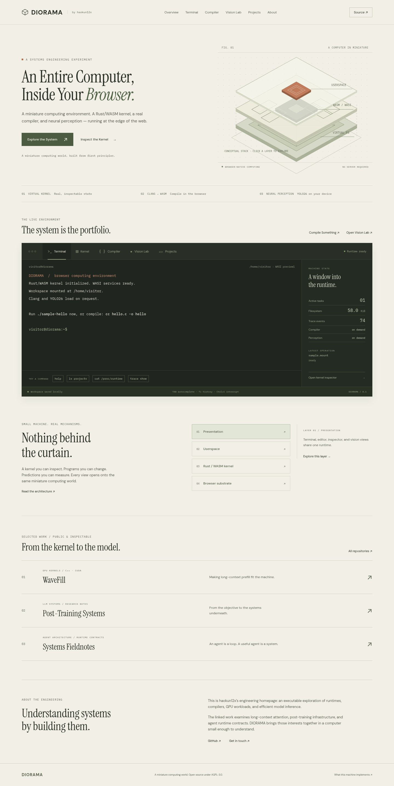

# DIORAMA

**An Entire Computer, Inside Your Browser.**

A miniature computing world, built from first principles. [Open the machine](https://haokun12x.github.io/diorama/) · [Architecture](docs/ARCHITECTURE.md) · [Limitations](docs/LIMITATIONS.md)

DIORAMA is an executable engineering homepage. Its terminal queries and modifies a shared filesystem, its process inspector follows actual runtime tasks, its compiler runs genuine Clang/LLD as WebAssembly, and its vision lab evaluates YOLO26 locally. The custom kernel and WASI system services execute as Rust/WebAssembly. The browser supplies the UI, shell, clocks, cryptographic entropy, storage transport, and worker control.



## Try it

```sh
help
./sample-hello  # real prebuilt WASI guest; no compiler download needed
ls projects
cat hello.c
cc hello.c -O2 -o hello
./hello
trace show
cat /proc/runtime
vision detect /samples/street.jpg --json
cat /tmp/vision/detections.json
vision segment /samples/street.jpg --model yolo26-seg
```

C source stays in the browser. Guest programs execute in disposable workers with bounded memory, timeouts, cancellation, and controlled VFS writes. Images and camera frames also stay local; camera capture requires a button click and browser permission. No backend or API key is required. Compiler and model assets load only on use. A 50 kB genuine prebuilt executable mounts at boot for immediate guest execution. User workspace files persist in IndexedDB.

## Run and verify

Requires Node.js 22 and Rust 1.90.0 with the wasm32-unknown-unknown target. npm and Cargo lockfiles fix both dependency graphs.

```sh
rustup toolchain install 1.90.0 --profile minimal --target wasm32-unknown-unknown
npm ci
npm run kernel     # compile authoritative kernel and WASI services to WASM
npm run assets     # self-host pinned compiler, model, and ONNX runtime artifacts
npm run dev
npm run typecheck
npm test
npm run test:rust
npm run build
npx playwright install --with-deps chromium
npm run test:e2e
npm run preview
```

Open the /diorama/ subpath printed by Vite. The asset preparation step downloads genuine upstream models and runtime files; generated heavy artifacts are ignored by Git and included in the deployment build. It adds small documented worker adapters and preserves upstream notices. `CHROMIUM_PATH` can select an existing Chromium. `DIORAMA_URL` runs browser acceptance tests against a deployed URL.

## What executes where

| Component | Execution |
|---|---|
| Kernel, VFS, tasks, descriptors, tracing, snapshots | Rust compiled to WebAssembly; authoritative state in WASM linear memory |
| Guest WASI preview1 system services | Separate instance of that Rust/WASM kernel in each guest worker |
| Shell, UI, IndexedDB transport, worker control | TypeScript/JavaScript in the browser |
| Clang 20.1.2 and LLD | Emscripten WebAssembly in a compiler worker |
| User-compiled C | WASI preview1 WebAssembly in a disposable guest worker |
| YOLO26 preprocessing/postprocessing | Official Ultralytics Rust compiled to WASM |
| Neural network | ONNX Runtime Web, WebGPU when available or single-threaded CPU/WASM |

The live task table records IDs, parents, lifecycle transitions, exit codes, cancellations, and observed guest memory. Tracing connects command dispatch, compiler initialization, WASI calls, filesystem access, and inference. The memory inspector renders actual bytes, not fabricated allocations. The homepage's stack drawing is explicitly conceptual.

## Implementation guides

- [Architecture](docs/ARCHITECTURE.md): boundaries, state, workers, security, and observability.
- [Kernel and shell](docs/KERNEL.md): actual semantics, commands, pipes, descriptors, snapshots.
- [Compiler](docs/COMPILER.md): toolchain, headers, linking, imports, limits, examples.
- [Vision](docs/VISION.md): official models, adapters, privacy, backend selection, camera queue.
- [Decisions](docs/DECISIONS.md): browsercc/native Clang/v86 feasibility and departures.
- [Benchmarks](docs/BENCHMARKS.md): measured validation and reproducibility.
- [License audit](docs/LICENSES.md): library, model, toolchain, and image terms.
- [Accepted scope](docs/SCOPE.md): SAM3 was explicitly cancelled by the owner; local YOLO26 segmentation remains.

Verified portfolio projects are represented both in the project explorer and /home/visitor/projects. Their descriptions link to public source evidence and distinguish source-reported results from DIORAMA measurements.

## GitHub Pages

Vite's production base is /diorama/. The workflow in .github/workflows/deploy.yml installs pinned Rust, compiles the WASM kernel, uses npm ci, prepares assets, typechecks, tests Rust and the actual WASM ABI, builds, and runs real browser compiler/inference tests before uploading and deploying the Pages artifact with official GitHub actions. Set **Settings → Pages → Source → GitHub Actions** for the repository. Pushes to main and manual workflow dispatch publish the site. Pages does not need COOP/COEP or SharedArrayBuffer: acceptance tests explicitly exercise a non-isolated context and CPU inference.

## License

DIORAMA's application source is AGPL-3.0-only, compatible with its Ultralytics dependency and model licensing. Source is publicly available through the persistent site source link. Third-party components retain their own licenses and notices; compiler and model redistribution terms are documented separately. No SAM3 weights, secrets, private keys, or access tokens are included.
