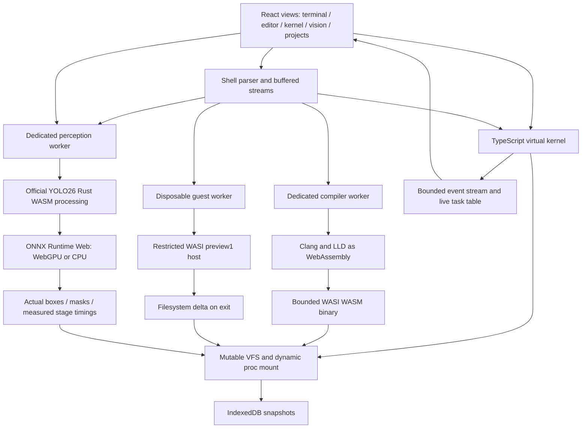

# DIORAMA architecture

All views share a single Kernel, FileSystem, Compiler, Vision, and Shell instance. The browser console exposes these as `window.diorama` for inspection. It is the same API used by acceptance tests.

## Kernel and process model

Each shell command, compiler invocation, guest, or inference receives a monotonically increasing PID, parent PID, name, kind, lifecycle state, creation time, termination time, exit code, cancellation controller, and observed memory count. PID 1 is the persistent shell waiting for input. These are runtime-managed browser tasks, not host operating-system processes.

`Kernel.run()` yields once to the browser event loop before dispatch. Task states record runnable, running, waiting, terminated, and cancelled transitions. There is no preemptive instruction scheduler, fork, or priority scheduler. Web Workers supply browser-managed parallel execution for compilation, guests, and inference. Killing a parent cancels its child tasks. Worker host wrappers enforce termination and clean descriptors/listeners/timers. The recent process table is bounded to approximately 128 entries; trace history is capped at 500.

## Files and streams

A VFS node is a directory or binary byte array. Paths normalize traversal against the shell working directory. Reads return copies. File writes enforce an 8 MiB file limit and 32 MiB workspace limit. Dynamic /proc readers query the current kernel on every read. The editor, shell, compiler, guest output, and vision JSON share this VFS.

Shell pipelines execute sequentially over bounded 1 MiB UTF-8 buffers. They are not concurrent Unix pipe file descriptors. `<`, `>`, `>>`, `2>`, and `2>>` route actual bytes/strings; /dev/null discards redirected output. Guest stdin is a finite buffer, and stdout/stderr return actual guest writes. Kernel descriptor methods maintain per-task fd, path, mode, and offset. During WASI calls the inspector receives the guest shim's actual descriptor list.

IndexedDB stores the visitor workspace as native byte-array snapshots with atomic readwrite transactions, avoiding expansion of binary files into large JavaScript number arrays. A 200 ms debounce avoids persisting each intermediate mutation. Restoration validates hierarchy and size before replacement. In-memory state remains usable if IndexedDB fails. Reset clears the stored snapshot and suppresses subsequent saves until reload.

## Compiler and guest boundaries

The compiler receives source text, flags, and local header contents from the VFS. It loads genuine Clang, linker, and WASI sysroot artifacts only when requested. Its Emscripten filesystem is separate from the workspace; inputs and outputs cross explicitly. Output bytes become an ordinary VFS file.

Each execution gets an isolated WASI filesystem snapshot. Read-only file flags and host checks restrict mutation to /home/visitor and /tmp. The host denies guest rename, links, symlinks, sockets, unsupported imports, shared memory, and memory without a maximum. Compiler-produced binaries declare a 64 MiB maximum. Only successful guest completion merges changed files back through a staged, atomic VFS delta; cancellation discards the worker snapshot. There is no ambient DOM, cookie, credential, or network interface exposed to WASM imports. Worker JavaScript itself is trusted application code, not a sandbox for arbitrary uploaded JavaScript.

## Perception

Inference runs in a persistent worker with exactly one active RPC/frame. The official model's Rust preprocessing/postprocessing and ONNX backend produce the results; no prediction fixture substitutes for the acceptance path. WebGPU is feature-detected by requesting a real adapter. CPU fallback and the explicit CPU option use single-threaded WASM. Download progress counts actual fetch bytes; initialization is reported as a separate state. Script/module imports may not provide byte progress.

Model input size is fixed at 640 × 640 in the selected exports. Thresholds and backend selection are configurable. Camera capture begins only on the camera button and browser permission grant, with audio disabled. Frames are captured after the previous frame completes, so an old-frame backlog cannot build. Stopping/unmounting stops the stream. Images and camera frames are processed locally; there is no inference endpoint, and upstream telemetry is disabled.

## Observability

Events contain timestamp relative to kernel boot, task identity, layer, operation, safe arguments, result, and measured duration for timed operations. Guest WASI traces cap at 300 calls per execution and report omitted counts. Linear memory statistics observe actual exported memory at instantiation, host calls, and exit. The 4 KiB memory display uses actual byte values, with 32 bytes per cell; it does not identify malloc allocations or claim to measure the JS heap. The isometric homepage stack is explicitly conceptual and links to real subsystems.
